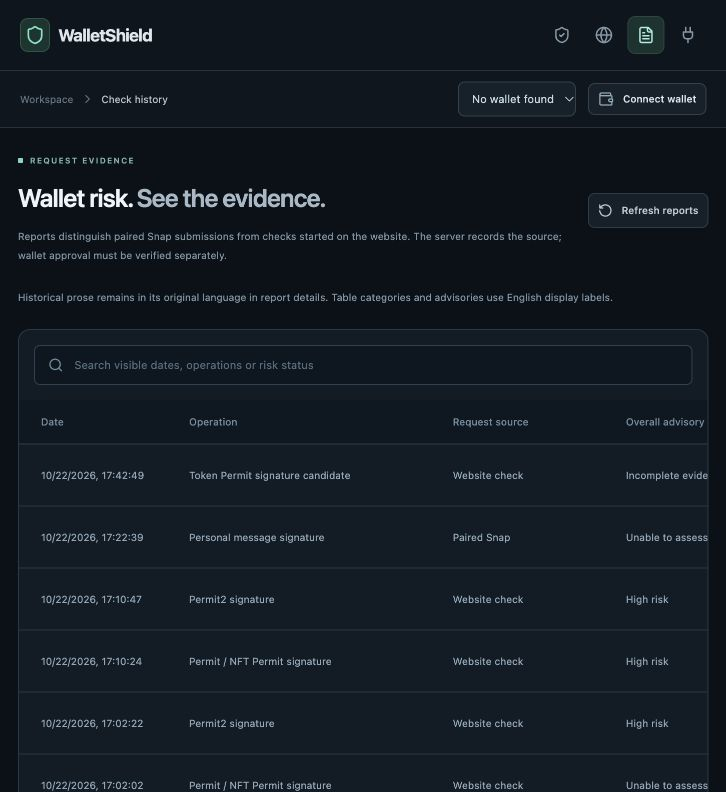

# Repair verification — 2026-10-22

Version: **0.4.1**. Scope: pre-sign EVM advice, with numeric assessments supplied by Meta Muse Wonder. This is a bounded correctness review, not an independent security audit or detection-accuracy certification.

## Verified changes

- Equivalent supported EIP-712 unsigned integer encodings retain the same interpreted authority without changing the signing digest. Unsigned extra JSON properties do not become signed intent.
- On-chain Permit2-shaped approval reads the underlying ERC-20 approval and internal final-spender allowance independently at a pinned block.
- Revocation and transfer recipients have distinct zero-address semantics; transferFrom balance warnings no longer claim authority over future deposits.
- Nonce/domain claim guards examine every displayed model field, exact cited checks, pass/risk direction and indexed batch entries. These remain bounded language guards, not a general truth verifier.
- Scope metadata separates the permanent canonical off-chain-purpose caveat from unfinished request checks. Full completeness/gap inventories remain unchanged. All other unknowns, newly identified gaps and timing/hash conflicts restrict low/strong conclusions. No numeric score, floor or fallback is computed locally.
- History clears and ignores obsolete responses across account/provider/disconnection and failed loads. Hosted report ownership enforcement remains in place; local mode intentionally shares one machine's history.
- Hosted Snap issuance uses atomic persistent per-address/IP/global budgets and active-credential ceilings, with owner-only rotation and no eviction on denial.
- Known production dependency advisories were addressed using supported static middleware and scoped dependency overrides.

## Validation results

| Check | Result and actual boundary |
| --- | --- |
| `npm test` | **231 passed, 0 failed**. Includes malformed evidence, claim bypasses, canonicalization, history races, pairing limits, scoped score validation, API persistence and rendered scope caveats. |
| `npm run typecheck` | Passed for application and Snap. |
| `npm run build` | Passed for local web and evaluated Snap bundle. The manifest checksum was regenerated. |
| `npm run test:lab` | **54 passed: 43 transactions and 11 message cases, representing 25 of 30 profiles.** Executed with local-node fixtures; Anvil snapshot restored. This does not prove MetaMask hook delivery or Snap UI acceptance. |
| `npm run test:security` | Passed isolated fixture execution/deltas, round-trip selling restriction, supplied-gas/stale-nonce preservation, upstream unchanged, Permit nonce/domain, vault preview and lending health factor. Legacy monitor helper tests do not enable post-sign monitoring. |
| Isolated hosted build/package rehearsal | Passed using a reserved `.example` domain and validation-only npm identity. `npm pack --dry-run` contained only README, bundle, icon, package and Snap manifest. Nothing was deployed or published. |
| Dependency audit | `npm audit --omit=dev`: **0 known findings**. Full audit: **12 low affected-package entries**, stemming from one unresolved `elliptic` advisory in the development/build dependency tree. This is a point-in-time audit, not a clean bill of security. |
| Documentation | English/Chinese guide synchronization, local links and generated Chinese manual checked. The coverage matrix explicitly separates automatic, manual, partial and uncovered paths. |
| Browser smoke check | Restarted local API/web/Snap services and verified the English lab/history pages. Existing records remained. The test browser had no wallet provider; no wallet signature or transaction was approved. |

The screenshot below shows retained **historical** reports, not newly scored or signed requests:

## Configuration and remaining validation

The existing local configuration reports Muse enabled/configured, GoPlus enabled, RPC chains 1/31337/11155111 and monitoring disabled. This review did not print or commit credentials, reset the user's chain, or call the paid model again. Model fixtures test the updated prompt/validation contract offline; live behavior of the updated prompt still needs a fresh wallet test after reloading and pairing the rebuilt Snap. Earlier live-model artifacts describe their own earlier inputs only.

The remaining low advisory is [GHSA-848j-6mx2-7j84](https://github.com/advisories/GHSA-848j-6mx2-7j84). No supported upstream patched `elliptic` release was available in this review. The audit's suggested major Snap CLI downgrade was not applied, nor was an unreviewed cryptographic patch invented to hide the finding.

For behavior coverage and remaining limitations, see [Current coverage](CURRENT-COVERAGE.md) / [当前覆盖范围](CURRENT-COVERAGE-zh.md). Main outstanding work includes model calibration and adversarial evaluation, deeper protocol adapters and trusted intelligence, wallet/dApp-only entry points, complete EIP-7702/ERC-4337/ERC-1271 support, and actual public deployment/distribution/operational acceptance.
